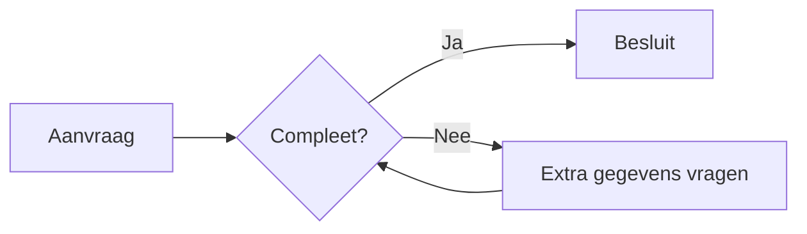

Een diagram is een plaatje. Mensen die het plaatje niet kunnen zien, lezen daarom een beschrijving. De korte titel staat bij de afbeelding. De lange beschrijving staat als verborgen tekst onder het diagram.

## Van aanvraag naar besluit

## Hetzelfde diagram, een tweede keer

Een tweede diagram met dezelfde titel krijgt een eigen bestand. De theme-hook telt dan door.

